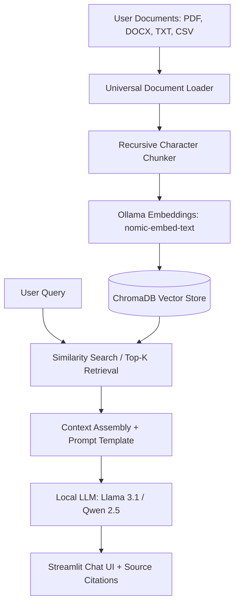

# 🔒 PrivateDoc RAG — Local & Offline Document Intelligence

[](https://www.python.org/)
[](https://www.langchain.com/)
[](https://ollama.com/)
[](https://streamlit.io/)
[](https://opensource.org/licenses/MIT)

**PrivateDoc RAG** is a production-ready, 100% offline Retrieval-Augmented Generation (RAG) assistant designed for confidential enterprise documents (legal, medical, financial, and internal technical documentation). 

It ensures **zero external cloud API calls**, keeping sensitive data entirely on-premise while providing precise answers with **page-level source citations**.

---

## 🌟 Key Features

- **100% Offline & Private:** Powered locally by [Ollama](https://ollama.com) (Llama 3.1, Llama 3.2, Qwen 2.5, Gemma 2). No data leaves your machine.
- **Multi-Format Document Ingestion:** Native parsing support for `.pdf`, `.docx`, `.txt`, `.csv`, and `.md`.
- **Exact Page-Level Citations:** Every response comes with an expandable source card indicating the document name, exact page number, and text context snippet.
- **Dynamic Model Switching:** Switch LLMs and adjust hallucination thresholds (`temperature`, `top_k`) directly in the UI.
- **Persistent Vector Store:** ChromaDB backend with disk persistence across application restarts.
- **1-Click Launchers:** Ready-to-use `.bat` and `.sh` startup scripts for non-technical users.

---

## 🏗️ Architecture & Workflow



---

## 🚀 Quickstart Guide

### Prerequisites
1. **Python 3.10+** installed on your system.
2. **Ollama** installed from [ollama.com](https://ollama.com).

### 1-Click Launch (Windows)
Double-click `run_app.bat`. It will automatically:
1. Install Python requirements.
2. Pull `llama3.1:8b` and `nomic-embed-text` in Ollama.
3. Launch the Streamlit web interface.

### Manual Setup (Linux / macOS / Windows)

```bash
# 1. Clone this repository
git clone https://github.com/your-username/private-document-rag.git
cd private-document-rag

# 2. Create and activate a virtual environment
python -m venv venv
source venv/bin/activate  # On Windows: venv\Scripts\activate

# 3. Install dependencies
pip install -r requirements.txt

# 4. Pull local models via Ollama
ollama pull llama3.1:8b
ollama pull nomic-embed-text

# 5. Run the application
streamlit run app.py
```

Open your browser at `http://localhost:8501`.

---

## 🐳 Docker Deployment

To run in a containerized environment:

```bash
# Build the Docker image
docker build -t privatedoc-rag .

# Run the container
docker run -p 8501:8501 --add-host=host.docker.internal:host-gateway privatedoc-rag
```

---

## 📂 Project Structure

```
private-document-rag/
├── core/
│   ├── document_loader.py    # Universal loader for PDF, DOCX, TXT, CSV, MD
│   ├── text_splitter.py      # Recursive semantic chunking
│   ├── vector_store.py       # ChromaDB vector store integration
│   └── rag_engine.py         # RetrievalQA pipeline & citation engine
├── tests/
│   └── test_document_loader.py # PyTest unit testing suite
├── app.py                    # Streamlit web interface
├── config.py                 # Centralized configuration
├── requirements.txt          # Python dependencies
├── Dockerfile                # Container deployment config
├── run_app.bat               # 1-Click launcher for Windows
├── run_app.sh                # 1-Click launcher for Unix
└── README.md                 # Project documentation
```

---

## 🧪 Running Unit Tests

```bash
pytest tests/
```

---

## 📄 License
This project is licensed under the MIT License — see the [LICENSE](LICENSE) file for details.
